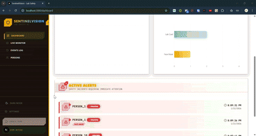

# SentinelVision

Offline event scoring for a future temporal-filter ablation is documented in [backend/eval/README.md](backend/eval/README.md). It evaluates saved intervals with one-to-one event matching, explicit cohort/provenance, false alerts per minute and signed onset differences. Only synthetic fixture tests have been run; this is not a new detector benchmark result.

Real-time PPE compliance monitoring for laboratories and industrial spaces.

SentinelVision is an event-driven video processing system that turns noisy, frame-level PPE detections into stable violation events (`start` / `end` / `duration` / `evidence`) under real-world constraints like occlusion, limited compute, and long-running streams.

## Demo



Live demo: https://lab-safety-monitor.vercel.app/
_Note: Live demo uses pre-recorded video feeds (not webcam access)_

## Problem, Constraints, and Overview

Safety monitoring breaks down when supervision is manual or reduced to frame-by-frame alerts. Manual checks don't scale, and per-frame predictions generate alert spam under occlusion and partial visibility.

The system must run in real time under limited compute, handle multiple people in frame, and keep false alerts low enough to be operationally useful. Under these constraints, single-frame predictions are weak signals, so the core challenge is temporal stability, not just per-frame accuracy.

SentinelVision uses an event-driven loop: video input -> person/PPE detection and association -> temporal filtering -> deduplicated event persistence -> dashboard/live WebSocket updates. Violations are modeled as stateful events that can start, continue, and end.

## Technical highlights (Key design choices)

Hybrid detection pipeline (lower association errors):

- YOLOv8 for person detection + tracking
- SAM3 for person masks
- YOLOv11 for PPE items and violation classes
- Cost: more moving parts and more compute than a single model

Temporal filtering (reduce alert spam):

- EMA confidence fusion across frames
- Hysteresis thresholds for starting/stopping violations
- Subset matching during short occlusions
- Cost: alerts can be delayed by a few frames

Streaming architecture (predictable latency):

- Display FPS and ML processing FPS are decoupled
- Frames can be cached and dropped to keep processing stable under load
- Cost: some frames are intentionally not processed

Event-centric persistence (audit-friendly output):

- Deduplicated ongoing events per person/video source
- Start frame, end frame, duration, evidence snapshot
- Associated identity when available

## Limitations

### Inference availability and demo mode

Real detector modes fail explicitly when required models cannot load or inference fails. SAM3, YOLOv11 PPE, and InsightFace never substitute mock detections or embeddings after an error. `/health` exposes pipeline readiness, inference mode, and an actionable error; video jobs become `failed` on model errors and webcam startup returns HTTP 503. Live processing clears stale detections and shows an unavailable overlay after errors.

For an intentional backend demo, set `DETECTOR_TYPE=mock` or `USE_MOCK_DETECTOR=true`. Mock frames are watermarked and carry `simulated: true` / `inference_mode: mock`; simulated people and violation events are not persisted. `USE_MOCK_FACE=true` explicitly selects labeled face simulations. The prerecorded frontend demo remains a separate simulation, not a model benchmark. Restore real settings and restart the backend before validating actual inference.

Lightweight failure-boundary tests (stubs only; no model loading or inference):

```bash
cd backend
python -m unittest discover -s tests -v
```

- Face recognition degrades under heavy occlusion or low resolution
- Multi-scale PPE detection increases GPU memory usage
- SQLite is used for local-first development and is not intended for horizontal scaling

## What I Learned

- I learned to design CV pipelines around deployment constraints (latency, occlusion, compute budget), not best-case samples.
- I improved at turning noisy detections into stable product behavior using temporal fusion, hysteresis, and event-state management.
- I learned to build backpressure-aware streaming paths (decoupled display/process FPS + frame dropping) to keep the UI responsive under load.
- I improved at shipping end-to-end ML systems, from inference and persistence to APIs and real-time frontend updates.

## Stack

- ML: Custom YOLOv11 PPE detector, YOLOv8, SAM3 (SAM2 fallback), InsightFace
- Backend: FastAPI (async), SQLAlchemy, SQLite
- Frontend: Next.js 16, React 19, Tailwind CSS 4
- Streaming: MJPEG + WebSockets for real-time updates
- Tooling: `uv`, `pnpm`

## Quick start

```bash
git clone https://github.com/garg-tejas/lab-safety-monitor.git
cd lab-safety-monitor
```

## Setup

Prereqs: Python 3.11+, Node.js 18+ (pnpm), `uv` (CUDA GPU recommended)

Backend (FastAPI):

```bash
cd backend
uv sync
cp .env.example .env
uv run uvicorn app.main:app --reload --host 0.0.0.0 --port 8000
```

Frontend (Next.js):

```bash
cd frontend
pnpm install
pnpm dev
```

URLs:

- UI: http://localhost:3000
- API docs: http://localhost:8000/docs

Model weights:

- SAM3: `backend/weights/sam3/sam3.pt`
- YOLOv11 PPE: `backend/weights/ppe_detector/best.pt`
- If you don't have SAM3 weights, disable SAM3 via env or download weights before running.

**Quick troubleshooting:** If you see CUDA OOM errors, set `MULTI_SCALE_ENABLED=false` in `.env` or reduce `LIVE_STREAM_PROCESS_FPS=1`.

## Usage

The API is easiest to explore via `http://localhost:8000/docs`.

Process a video file:

```bash
curl -X POST http://localhost:8000/api/stream/upload \
  -F "file=@lab_demo.mp4"

curl -X POST http://localhost:8000/api/stream/process \
  -H "Content-Type: application/json" \
  -d '{"video_path": "lab_demo.mp4"}'
```

Start/stop live monitoring:

```bash
curl -X POST http://localhost:8000/api/stream/live/start
curl -X POST http://localhost:8000/api/stream/live/stop
```

## Project structure

- `backend/app/api/routes/`: REST endpoints
- `backend/app/ml/`: ML pipeline
- `backend/app/services/`: persistence + deduplication
- `backend/weights/`: model weights
- `frontend/src/app/`: pages
- `frontend/src/components/`: UI components
- `data/`: videos, processed outputs, snapshots

## Configuration

Copy `backend/.env.example` to `backend/.env`, then adjust relevant settings:

- `REQUIRED_PPE`
- `DETECTION_CONFIDENCE_THRESHOLD`, `VIOLATION_CONFIDENCE_THRESHOLD`
- `TEMPORAL_FUSION_STRATEGY`, `TEMPORAL_EMA_ALPHA`, `TEMPORAL_*_MIN_FRAMES*`
- `LIVE_STREAM_DISPLAY_FPS`, `LIVE_STREAM_PROCESS_FPS`, `LIVE_STREAM_QUEUE_SIZE`
- `MULTI_SCALE_ENABLED`, `MULTI_SCALE_FACTORS`
- `USE_SAM3`, `USE_SAM2`
- `DATABASE_URL`
- `ENABLE_SNAPSHOT_CAPTURE`, `SNAPSHOTS_DIR`

## API

OpenAPI docs are available at `http://localhost:8000/docs` when the backend is running.

## ML models

Custom YOLOv11 PPE detector (trained with 12 classes):

- PPE items: `goggles`, `mask`, `lab_coat`, `gloves`, `head_mask`
- Violations: `no_goggles`, `no_mask`, `no_lab_coat`, `no_gloves`, `no_head_mask`
- Actions: `drinking`, `eating`

Pre-trained models:

- YOLOv8-medium (person detection + tracking)
- SAM3 (segmentation), SAM2 fallback
- InsightFace (ArcFace) for face embeddings
